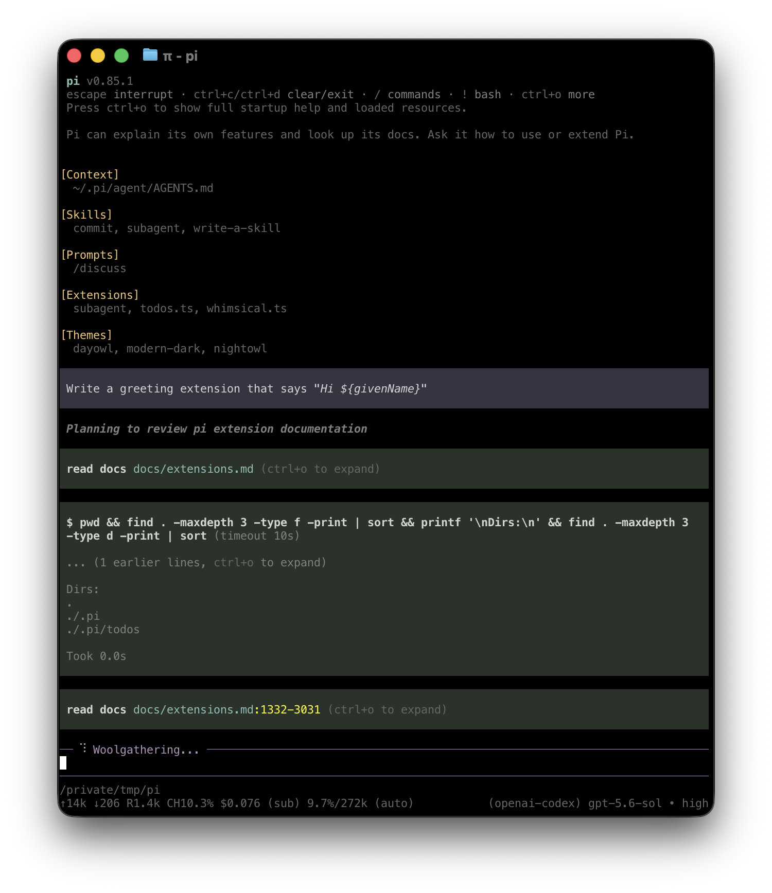

# Quickstart

Noushi runs in your terminal and works with files on your machine. To use it, you need access to a model through a supported provider. This can be a subscription, an API key, or a local model.

For native Windows setup, read [Windows Setup](windows.md). For Android, read [Termux Setup](termux.md).

## 1. Install Noushi

Install Noushi from npm. This requires Node.js 22.19 or newer:

```bash
npm install -g --ignore-scripts @noushi/cli
```

Noushi does not require dependency lifecycle scripts for a normal npm installation. The npm installation updates with `noushi update`; to upgrade past npm itself, reinstall the package at the new version.

Verify the installation:

```bash
noushi --version
```

## 2. Start Noushi

Change to the folder you want Noushi to work with, then start it:

```bash
cd /path/to/folder
noushi
```

The working folder helps Noushi discover relevant files, instructions, and configuration. Noushi also uses it to group saved sessions.

<p align="center"></p>

The interface shows your conversation, an editor for prompts and commands, and a footer with the current folder, model, and session status. See [Use Noushi in the terminal](usage.md) to learn how to add files, run commands, direct ongoing work, and manage results.

## 3. Choose a model

A **model** generates Noushi's responses. A **provider** is the service or account Noushi uses to access that model.

In Noushi, run:

```text
/login
```

Choose a provider, then follow the prompts to use a subscription or store an API key. Run `/model` afterward if you want to select a different available model.

See [Choose a model and provider](models.md) for supported providers, environment-variable authentication, local models, and custom endpoints.

## 4. Give Noushi a task

Noushi shows each file read, search, command, and edit it performs. It does not ask before every tool call.

Enter a task that matches your work, for example:

```text
Summarize @meeting-notes.md and save the action items to action-items.md.
```

```text
Explain how this repository is structured and how to run its checks.
```

```text
Compare @previous.csv with @current.csv and summarize the important changes.
```

Type `@` in the editor to search for a file instead of entering its full path. When Noushi finishes, review its response and any changed files. Use version control or backups for important work. For untrusted or unattended work, use a container or another sandbox. See [Security](security.md).

## Continue later

Noushi saves sessions automatically. Exit Noushi, then resume the most recent session for the same working folder with:

```bash
noushi --continue
```

Use `/resume` to choose another saved session. See [Continue or branch a session](sessions.md) for session naming, branching, compaction, export, and sharing.

## Next steps

- [Use Noushi interactively](usage.md) to learn input, commands, shortcuts, and queued messages.
- [Add instructions](configuration.md#context-files) that Noushi should follow whenever it works in a folder.
- [Choose a model and provider](models.md).

### Choose how to customize Noushi

Start with the least powerful mechanism that meets your need:

| Need | Start with |
|---|---|
| Give Noushi persistent instructions for a folder | [`AGENTS.md`](configuration.md#context-files) |
| Reuse a prompt from the `/` menu | [Prompt template](prompt-templates.md) |
| Add task-specific instructions and supporting files | [Skill](skills.md) |
| Add executable tools, commands, or event handlers | [Extension](extensions.md) |
| Build a custom terminal component | [Terminal UI](tui.md) |
| Connect an unsupported model service | [Custom provider](custom-provider.md) |
| Install or distribute several resources | [Noushi package](packages.md) |

## Uninstall Noushi

If you installed Noushi with npm, run:

```bash
npm uninstall -g @noushi/cli
```

If you installed Noushi another way (clone plus launcher, or a linked workspace), remove that checkout or symlink instead.

None of these methods removes configuration, credentials, sessions, or installed Noushi packages from `~/.noushi/agent/`.
